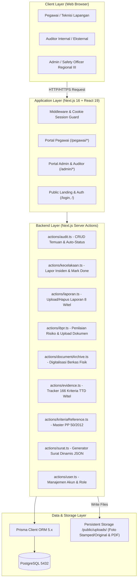
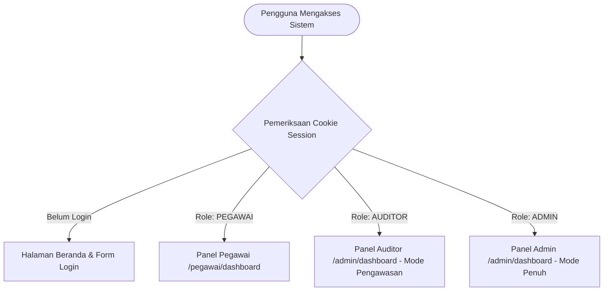
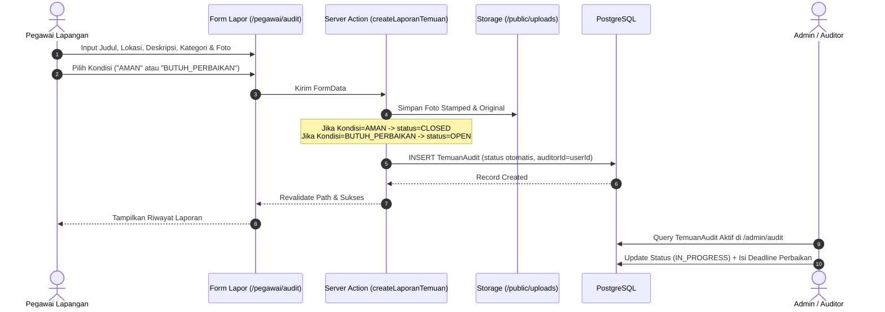
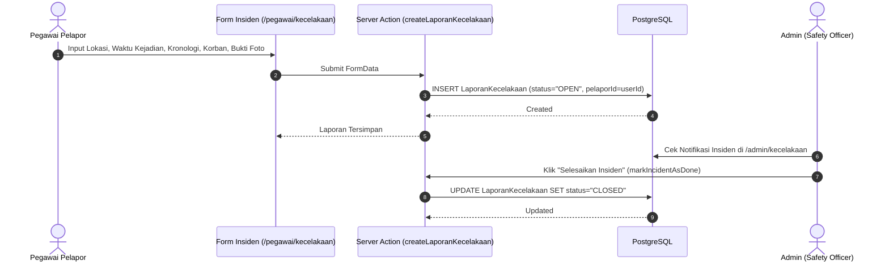
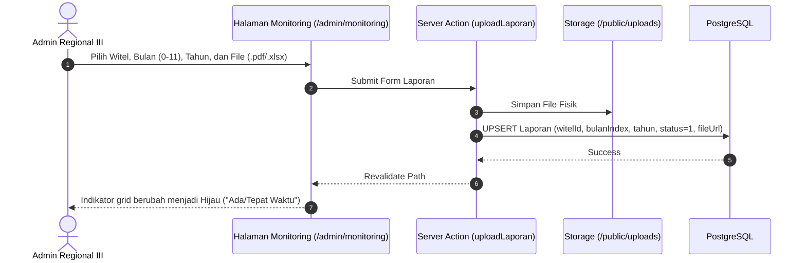

# DOKUMEN RANCANGAN DAN IMPLEMENTASI SISTEM WEB-SMK3
## Sistem Informasi Monitoring Keselamatan & Kesehatan Kerja (SMK3)
### PT Telkom Indonesia (Persero) Tbk — Divisi Telkom Regional III Surabaya

---

## 1. DESKRIPSI DAN TUJUAN PROYEK

Aplikasi **WEB-SMK3** adalah sistem informasi berbasis web yang dikembangkan khusus untuk **Tim General Support PT Telkom Indonesia Regional III Surabaya** guna mendigitalisasi pengelolaan, pemantauan, dan audit Keselamatan dan Kesehatan Kerja (K3) yang mencakup 8 Wilayah Telekomunikasi (Witel):
1. Witel Suramadu
2. Witel Solo (Jateng Timur)
3. Witel Semarang (Jateng Utara)
4. Witel Yogyakarta (Jateng Selatan)
5. Witel Jatim Timur
6. Witel Jatim Barat
7. Witel Bali
8. Witel Nusa Tenggara

Sistem ini mengacu pada standar **PP No. 50 Tahun 2012 tentang Penerapan SMK3** dan regulasi internal Telkom untuk memastikan seluruh proses pelaporan insiden, inspeksi bahaya, monitoring laporan berkala witel, manajemen risiko (IBPR), serta repositori dokumen bukti audit (*evidence*) terpusat dalam satu platform.

---

## 2. ARSITEKTUR TEKNIS SISTEM

Aplikasi ini menggunakan pola arsitektur **Fullstack Jamstack / Server-Driven Web Application** dengan Next.js App Router (React 19), Prisma ORM, dan PostgreSQL dalam container Docker.



---

## 3. RANCANGAN PERAN PENGGUNA & HAK AKSES (ROLE-BASED ACCESS CONTROL)

Sistem mengelola hak akses menggunakan **3 Role Pengguna Utama** yang tersimpan di kolom enum `Role` pada basis data PostgreSQL:



### 3.1 Rincian Fungsi Tiap Role

#### A. Role: ADMIN (Super Administrator / Safety Officer Regional)
* **Dashboard Eksekutif**: Memantau statistik ringkasan (Total Temuan Aktif, Insiden Terbuka, Total IBPR, Pengguna) dan grafik tren kecelakaan kerja per bulan menggunakan library `Recharts`.
* **Dokumen IBPR**: Mendaftarkan titik bahaya ruangan, menentukan tingkat peluang (*likelihood*) dan dampak risiko (*consequence*), mengunggah foto ruangan serta dokumen PDF panduan K3.
* **Monitoring Jam Kerja 8 Witel**: Memantau matriks pengumpulan laporan bulanan (12 bulan x 8 Witel), mengunggah berkas laporan (`.pdf`, `.xlsx`), atau menghapus laporan beserta file fisik di server.
* **Data Audit K3**: Mengelola temuan lapangan, menindaklanjuti perbaikan, mengisi target batas waktu (*deadline*), dan mengubah status (`OPEN` ➔ `IN_PROGRESS` ➔ `CLOSED`).
* **Laporan Insiden**: Menerima laporan kecelakaan kerja dan memprosesnya hingga selesai (`markIncidentAsDone`).
* **Arsip Dokumen**: Mengelola arsip berkas fisik K3 (Nomor Berkas, Judul, Divisi, Dokumen PDF Scan, Status Digital).
* **Evidence SMK3 Tracker**: Mengelola matriks ketersediaan dokumen bertanda tangan (TTD) 166 kriteria per area Witel dan periode tahun.
* **Referensi Kriteria**: Mengelola berkas regulasi pendukung klausul PP 50/2012.
* **Manajemen Pengguna (User Management)**: Menambah, mengubah role, mereset password, dan menghapus akun.
* **Pembuatan & Arsip Surat**: Merancang surat resmi (Undangan/Laporan) dengan formulir dinamis berbasis JSON dan fungsi *print-to-PDF*.

#### B. Role: AUDITOR (Safety Inspector Internal / Eksternal)
* **Dashboard Monitoring**: Memantau matriks kinerja K3 di seluruh wilayah Telkom Regional III.
* **Validasi Audit**: Memeriksa temuan bahaya lapangan dari teknisi, memvalidasi kategori (`KRITIKAL`, `MAYOR`, `MINOR`), serta memastikan kondisi perbaikan (`AMAN` vs `BUTUH_PERBAIKAN`).
* **Pemeriksaan Evidence & Kriteria**: Mengevaluasi kelengkapan dokumen bertanda tangan per Witel untuk persiapan audit eksternal.
* **Akses Dokumen IBPR & Arsip**: Meninjau matriks identifikasi bahaya dan arsip keselamatan tanpa akses modifikasi akun user.

#### C. Role: PEGAWAI (Teknisi Lapangan / Staff Witel)
* **Dashboard Personal**: Melihat riwayat pelaporan pribadi (*unsafe condition* dan insiden) beserta status penanganannya.
* **Lapor Bahaya (Audit K3)**: Mengisi form laporan kondisi tidak aman dengan bukti foto langsung dari kamera (disertai opsi foto original & stamped watermark).
* **Lapor Insiden Kecelakaan**: Mengirim laporan kecelakaan darurat (waktu kejadian, lokasi, kronologi, korban, dan foto).
* **Pencarian & Unduh Arsip Dokumen**: Mencari dan mengunduh SOP, instruksi kerja, serta referensi kriteria keselamatan kerja.
* **Document Tools**: Memanfaatkan kamera ber-watermark otomatis (lokasi GPS, timestamp waktu, logo Telkom) untuk keperluan dokumentasi inspeksi.

---

### 3.2 Matriks Hak Akses Modul (CRUD Matrix)

| Modul / Fitur Sistem | Rute Halaman | Pegawai | Auditor | Admin |
| :--- | :--- | :---: | :---: | :---: |
| **Dashboard & Grafik Tren** | `/admin/dashboard` / `/pegawai/dashboard` | Read (Own) | Read (All) | Read (All) |
| **Lapor Temuan Bahaya** | `/pegawai/audit` & `/admin/audit` | Create, Read (Own) | Read (All), Update Status | Create, Read, Update, Delete |
| **Lapor Insiden Kecelakaan** | `/pegawai/kecelakaan` & `/admin/kecelakaan`| Create, Read (Own) | Read (All) | Create, Read, Update (Close), Delete |
| **Monitoring 8 Witel** | `/admin/monitoring` | ❌ | Read | Create, Read, Update, Delete |
| **Dokumen IBPR** | `/admin/ibpr` | ❌ | Read | Create, Read, Update, Delete |
| **Arsip Dokumen Digital** | `/admin/archive` & `/pegawai/archive` | Read, Download | Read, Download | Create, Read, Update, Delete |
| **Evidence SMK3 Tracker** | `/admin/evidence` & `/pegawai/evidence` | Read, Download | Read, Download, Verify | Create, Read, Update, Delete |
| **Referensi Kriteria PP 50**| `/admin/kriteria-referensi` | Read, Download | Read, Download | Create, Read, Update, Delete |
| **Pembuat Surat & Arsip** | `/admin/surat` & `/admin/arsip` | ❌ | Read | Create, Read, Print, Delete |
| **Manajemen Pengguna** | `/admin/users` | ❌ | ❌ | Create, Read, Update, Delete |
| **Document Tools (Camera)** | `/admin/document-tools` / `/pegawai/document-tools`| Execute | Execute | Execute |

---

## 4. RANCANGAN SKEMA BASIS DATA (PRISMA POSTGRESQL)

```mermaid
erDiagram
    USER ||--o{ TEMUAN_AUDIT : "melaporkan / verifikasi"
    USER ||--o{ LAPORAN_KECELAKAAN : "melaporkan insiden"
    WITEL ||--o{ LAPORAN : "memiliki laporan bulanan"

    USER {
        string id PK "cuid"
        string email UK "Email unik Telkom"
        string name "Nama lengkap"
        enum role "ADMIN | AUDITOR | PEGAWAI"
        string password "Hashed / default"
        datetime createdAt
        datetime updatedAt
    }

    TEMUAN_AUDIT {
        string id PK "uuid"
        string judul "Judul temuan"
        string deskripsi "Deskripsi kondisi bahaya"
        string lokasi "Lokasi temuan"
        enum kategori "KRITIKAL | MAYOR | MINOR"
        string buktiFoto "Path file / JSON stamped-original"
        enum status "OPEN | IN_PROGRESS | CLOSED"
        datetime deadline "Target selesai"
        datetime waktuTemuan "Waktu riil kejadian"
        string auditorId FK "User ID pelapor"
        enum kondisi "AMAN | BUTUH_PERBAIKAN"
        datetime createdAt
    }

    LAPORAN_KECELAKAAN {
        string id PK "uuid"
        string judul "Judul insiden"
        string lokasi "Lokasi kejadian"
        datetime waktuKejadian "Waktu insiden (wajib)"
        text kronologi "Kronologi kejadian"
        string korban "Nama korban"
        string fotoBukti "Path foto insiden"
        string status "OPEN | INVESTIGASI | CLOSED"
        string pelaporId FK "User ID pelapor"
        datetime createdAt
        datetime updatedAt
    }

    WITEL {
        int id PK "autoincrement"
        string nama "Nama 8 Witel Telkom Regional III"
    }

    LAPORAN {
        int id PK "autoincrement"
        int witelId FK "Relasi Witel"
        int bulanIndex "Indeks bulan (0 - 11)"
        int tahun "Tahun laporan (cth: 2026)"
        int status "1: Ada, 2: Telat"
        string fileName "Nama asli file"
        string fileUrl "URL path file di server"
        datetime uploadedAt
    }

    IBPR {
        string id PK "cuid"
        string lokasi "Lokasi / Ruangan"
        string aktivitas "Aktivitas kerja"
        string bahaya "Potensi bahaya teridentifikasi"
        string peluang "Peluang risiko"
        string penanganan "Tindakan mitigasi"
        string fotoRuangan "Path foto ruangan"
        string dokumenIbpr "Path file PDF panduan"
        datetime createdAt
        datetime updatedAt
    }

    DOCUMENT_ARCHIVE {
        string id PK "cuid"
        string documentNumber "Nomor dokumen fisik"
        string title "Judul dokumen"
        string documentType "Jenis berkas"
        datetime documentDate "Tanggal dokumen"
        string division "Divisi (General Support)"
        string digitalStatus "Sudah Digital | Belum Digital"
        string filePath "Path scan PDF/Foto"
        datetime createdAt
        datetime updatedAt
    }

    EVIDENCE_SMK3 {
        string id PK "cuid"
        string itemCode "Kode item (cth: LP.00.00.01)"
        string area "Area Witel / Regional III"
        int periode "Tahun periode (cth: 2026)"
        string fileName "Nama berkas upload"
        string filePath "Path URL file server"
        string keterangan "Catatan audit"
        string uploadedBy "Nama pengunggah"
        datetime uploadedAt
        datetime updatedAt
    }

    KRITERIA_REFERENCE_DOC {
        string id PK "cuid"
        string kriteriaNo UK "Nomor Kriteria PP 50 (cth: 1.2.5)"
        string docNumber "Nomor regulasi / pedoman"
        string docTitle "Judul dokumen K3"
        string filePath "Path file PDF"
        string fileName "Nama file asli"
        string keterangan "Catatan kriteria"
        string updatedBy "Nama editor terakhir"
        datetime createdAt
        datetime updatedAt
    }

    ARSIP_SURAT {
        string id PK "cuid"
        string nomor "Nomor surat resmi"
        string perihal "Perihal surat"
        string type "UNDANGAN | LAPORAN"
        json data "Data dinamis format surat"
        datetime createdAt
        datetime updatedAt
    }
```



---

## 5. ALUR KERJA UTAMA SISTEM (ACTIVITY FLOW)

### 5.1 Alur Pelaporan Temuan Bahaya & Otomatisasi Status



### 5.2 Alur Pelaporan dan Resolusi Insiden Kecelakaan



### 5.3 Alur Monitoring Pengumpulan Laporan 8 Witel



---

## 6. STRUKTUR DIREKTORI & MODUL KODE

```text
WEB-SMK3/
├── app/
│   ├── actions/                   # Backend Server Actions (CRUD & Bisnis Logika)
│   │   ├── audit.ts               # Lapor Temuan, Auto-Status, Update & Hapus
│   │   ├── auth.ts                # Action Logout
│   │   ├── documentArchive.ts     # Action CRUD Arsip Digital Berkas Fisik
│   │   ├── evidence.ts            # Action Matrix Upload Evidence TTD Witel
│   │   ├── ibpr.ts                # Action CRUD Identifikasi Bahaya & Risiko Ruangan
│   │   ├── kecelakaan.ts          # Action Lapor Insiden & Mark Done
│   │   ├── kriteriaReference.ts   # Action CRUD Dokumen Regulasi PP 50/2012
│   │   ├── laporan.ts             # Action Upload & Hapus Laporan Bulanan 8 Witel
│   │   ├── surat.ts               # Action CRUD Arsip Surat JSON Dinamis
│   │   └── user.ts                # Action Hapus & Modifikasi Pengguna
│   ├── admin/                     # Antarmuka Khusus Role ADMIN & AUDITOR
│   │   ├── archive/               # Modul Digitalisasi Dokumen Fisik
│   │   ├── arsip/                 # Modul Riwayat Arsip Surat Resmi
│   │   ├── audit/                 # Modul Review Temuan Audit & Penetapan Deadline
│   │   ├── dashboard/             # Dashboard Analitik Eksekutif & Chart Recharts
│   │   ├── document-tools/        # Tools Watermark, Stempel & Timestamp Dokumen
│   │   ├── evidence/              # Modul Matrix Tracker 166 Kriteria TTD Witel
│   │   ├── ibpr/                  # Modul Formulir & Tabel Matriks Risiko IBPR
│   │   ├── kecelakaan/            # Modul Monitoring & Investigasi Insiden
│   │   ├── kriteria-referensi/    # Modul Master Pedoman Regulasi PP 50/2012
│   │   ├── monitoring/            # Modul Grid Monitoring Laporan 8 Witel
│   │   ├── surat/                 # Modul Pembuat Surat K3 (Format JSON Fleksibel)
│   │   ├── users/                 # Modul Manajemen Akun & Hak Akses Pengguna
│   │   ├── AdminHeader.tsx        # Header Panel Admin (Profil, Dark Mode, Notif)
│   │   ├── AdminSidebar.tsx       # Sidebar Navigasi Admin
│   │   └── layout.tsx             # Server Route Guard Panel Admin
│   ├── pegawai/                   # Antarmuka Khusus Role PEGAWAI (Teknisi)
│   │   ├── archive/               # Repositori Pencarian & Unduh Arsip Dokumen
│   │   ├── audit/                 # Form Lapor Bahaya & Riwayat Laporan Pegawai
│   │   ├── dashboard/             # Dashboard Personal & Notifikasi Progres
│   │   ├── document-tools/        # Kamera Watermark & Geotagging Mandiri
│   │   ├── evidence/              # Repositori Template Evidence SMK3
│   │   ├── kecelakaan/            # Form Lapor Insiden Kecelakaan Kerja
│   │   ├── kriteria-referensi/    # Repositori Baca Dokumen Referensi Standar K3
│   │   ├── components/            # SidebarContent, PegawaiHeader, PegawaiLayoutClient
│   │   └── layout.tsx             # Server Route Guard Panel Pegawai
│   ├── login/                     # Halaman Login Multi-Role
│   ├── layout.tsx                 # Root Layout Aplikasi
│   └── page.tsx                   # Landing Page Publik & Auto Role Router
├── lib/
│   ├── prisma.ts                  # Singleton Prisma Client Instance
│   └── riskMatrix.ts              # Utilitas Kalkulasi Matriks Risiko IBPR
├── prisma/
│   ├── schema.prisma              # Definisi Database Schema PostgreSQL
│   └── seed.ts                    # Seeder Akun Default, 8 Witel & Data Awal
└── public/
    └── uploads/                   # Folder Fisik Penyimpanan Foto & PDF (Persistent Volume)
```

---

## 7. DEPLOYMENT & INFRASTRUKTUR

1. **Pipeline CI/CD Otomatis (.drone.yml)**:
   - Setiap `git push` ke branch `main` memicu Drone CI runner di server produksi Telkom Regional III.
   - Script otomatis membuat file `.env`, menjalankan build multi-stage Docker, migrasi database (`npx prisma migrate deploy`), dan reload container di port `3065` (`http://smk3.treg3.com`).
2. **Persistent Storage**:
   - Direktori `public/uploads` dihubungkan ke host server fisik via Docker Compose volume binding (`./public/uploads:/app/public/uploads`), mencegah hilangnya foto bukti insiden dan berkas PDF saat container di-rebuild.
